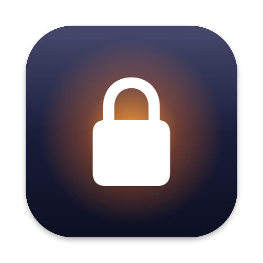

<p align="center">
  
</p>

<h1 align="center">Clearlock</h1>

<p align="center">
  Lock your Mac without stopping your work.<br>
  Keeps it awake and locks out everyone but you, while AI agents, builds and downloads keep running.
</p>

<p align="center">
  <a href="https://github.com/farhan2077/clearlock/releases/latest"></a>
  
  
</p>

Like a glass case: everything stays visible, but nothing can be touched.

## Features

- **Lock in one keystroke.** Press ⇧⌘L, or choose Lock Now from the menu bar. You can change the shortcut.
- **Unlock with Touch ID or your password.** A small glass pill shows the fingerprint; start typing to use your login password instead.
- **Your agents keep working.** Only your keyboard, mouse and trackpad are blocked. Apps, scripts and AI agents carry on as normal.
- **Stays awake.** Your Mac and its display don't go to sleep while Clearlock is running.
- **Nobody gets around it.** App switching, Force Quit and Log Out are disabled while locked, and repeated wrong guesses have to wait. You're told about every failed attempt after you unlock.
- **Make it yours.** Choose where the unlock pill sits, how much the screen dims, and the color of the menu bar lock.
- **Keeps running with the lid closed** (optional), only when plugged in if you like.
- **Light on your Mac.** About 15 MB of memory and no CPU use while idle. A built-in Diagnostics window shows exactly what it costs.
- **Updates itself** from GitHub Releases.

## Install

1. Download the `.dmg` from the [latest release](https://github.com/farhan2077/clearlock/releases/latest), open it and drag **Clearlock** to Applications.
2. Open it. macOS will warn that it can't check the app, because Clearlock isn't notarized. Go to **System Settings › Privacy & Security** and click **Open Anyway**. You only need to do this once.
3. Allow **Accessibility** when asked, so Clearlock can block your keyboard and mouse while letting agents through.

Requires macOS 26 or later.

## Uninstall

Quit Clearlock and move it to the Trash. If you turned on "Keep running with the lid closed", also run:

```bash
sudo rm /etc/sudoers.d/clearlock
```

To forget your settings too, delete `~/.config/clearlock`.

## Building from source

```bash
scripts/build.sh --run    # build and launch
scripts/test.sh           # run the tests
```

Project rules and technical details are in [CLAUDE.md](CLAUDE.md).

---

<p align="center">
  Built by <a href="https://farhanbinamin.com">Farhan Bin Amin</a> · <a href="https://github.com/farhan2077/clearlock">github.com/farhan2077/clearlock</a>
</p>
